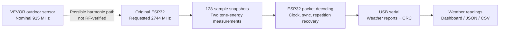

# ESP32-Harmonic-RX

**Experimental two-tone RF capture with an original ESP32, with a VEVOR YT60234 weather-station example.**

[](https://github.com/aobeidat85/ESP32-Harmonic-RX/actions/workflows/ci.yml) · [Releases](https://github.com/aobeidat85/ESP32-Harmonic-RX/releases) · [GPL-3.0-only](LICENSE)

An Arduino capture library, Python decoder, and local dashboard developed from a working bench experiment. Receiver hardware is one ESP32 development board and its USB cable; the ESP32 decodes packets and a PC displays the weather reports. A Python RF decoder remains available for recorded captures and explicit raw diagnostics.

> **RF interpretation:** VEVOR weather payloads were recovered with a requested receive setting of **2744 MHz**, near an apparent **2.745 GHz** signal. A third harmonic of the nominal 915 MHz transmitter is a plausible explanation. Absolute frequency/PLL lock and the harmonic origin have not been independently measured. **This project does not demonstrate native 915 MHz reception.**


Live dashboard captured on November 3, 2026. Values are actual received readings; rain is the sensor's cumulative total.

[Dashboard guide and screenshots](docs/DASHBOARD.md) · [How it works](docs/HOW_IT_WORKS.md) · [API and protocol](docs/API.md) · [Validation and limitations](docs/VALIDATION.md)

## Features

- **One ESP32 and a USB cable.** No additional receiver module is used in the tested setup.
- **Onboard decoding.** Clock recovery, repetition combining, and packet checks run on the ESP32; USB carries weather reports and compact diagnostics.
- **Coordinated units.** Select Fahrenheit for mph and inches, or Celsius for km/h and millimetres. The choice is remembered in the browser.
- **Local dashboard.** Live and saved readings, history charts, packet inspection, CSV export, and receiver controls.
- **Visible diagnostics.** Capture outcomes, validation failures, measured decoding time, USB report size, and persistent logs.

| Dashboard selection | Temperature | Wind and gusts | Cumulative rain |
|---|---|---|---|
| °F | Fahrenheit | mph | inches |
| °C | Celsius | km/h | mm |

Unit changes affect the display. Stored readings and CSV field units remain explicit and unchanged. See the [dashboard guide](docs/DASHBOARD.md) for conversions and screenshot details.

## The idea

Instead of transferring every I/Q sample over a slow USB-to-UART bridge, the ESP32 repeatedly captures a short RF snapshot and measures the energy at two configured tone offsets. The ESP32 reconstructs the FSK symbol clock, finds the VEVOR packet, validates it, and extracts the weather fields. Normal reception sends only CRC-framed weather reports and compact diagnostic summaries over USB. The dashboard does not run RF decoding in this mode.

The ESP32 captures **128 nominal 16 MS/s samples per observation** and gathers observations over a **150 ms window**. Reception has gaps; this is not continuous SDR streaming. The measured observation spacing in the original experiment was typically 35–36 µs.



The Arduino library performs capture and tone measurement. **VEVOR packet decoding now runs on the ESP32** in the included example. The PC still validates received reports and displays the fields. No router credentials or Internet connection are needed for reception.

The [onboard Receiver panel](docs/images/dashboard-onboard-decoder.png) shows decoding time and USB report size. On the tested board, all 11 saved RF fixtures matched the reference, with 0.57-0.76 second decoder runtimes. A short live check then received six consecutive bursts about 20 seconds apart. See [the validation record](docs/VALIDATION.md); this is not a long-term reliability or range measurement. Capture and decoding remain sequential.

## Example station

The demonstrated device is the **VEVOR YT60234 US variant, 7-in-1 outdoor weather station**:

- [User-supplied product listing — Amazon ASIN B0CHFBHK8N](https://www.amazon.com/dp/B0CHFBHK8N)
- [VEVOR protocol reference in rtl_433](https://github.com/merbanan/rtl_433/blob/master/src/devices/vevor_7in1.c)

This is one tested station/board combination. The EU868 MHz variant and other VEVOR products have not been tested with this profile. The example's sensor ID and tone offsets are measurements from one installation, not universal constants.

## What was verified

| Item | Bench result |
|---|---|
| Receiver | ESP32-D0WD-V3, revision 3.1, at 240 MHz |
| Receiver profile | Requested 2744 MHz; tone offsets 808500 Hz and 1018000 Hz; gain index 65 |
| Station ID in the recorded fixture | `14AB` |
| Final faster-sampler prototype test | Four accepted weather payloads across five predicted bursts |
| Fresh local-clock troubleshooting run | New validated packets received by the refactored library and dashboard; see validation record |
| Between-burst controls | No accepted weather payloads |
| Recovered fixture temperature | 19.8°C / 67.6°F |
| Console comparison | User reported 67.8°F; the readings differ by 0.2°F |
| Recovered and console humidity | 82% |
| Tested interpretation | Correctly structured weather payloads with checksum and counter checks |
| Unverified | Absolute RF frequency, actual PLL lock, harmonic origin, direct 915 MHz reception, useful range |

Current screenshots show the onboard decoder and latest unit controls during live reception. The [screenshot gallery](docs/DASHBOARD.md#screenshots) distinguishes these from earlier prototype images. Wind, rain, UV, light, and battery fields are decoded but were not independently compared with the console.

The simple additive checksum can miss compensating bit errors. Stable IDs, repeated fields, console comparison, and negative controls provide additional evidence; they do not make reception error-free. Up to two errors are permitted in the 40-bit sync pattern. No payload bits are flipped to force a checksum match. When independent copies fail, the decoder can combine measured symbol evidence from repeated copies, then apply all the same payload checks. A further fallback fits phase to the known sync waveform, keeping the measured symbol period and all payload checks. Readings report their recovery method and repetition count.

## Supported build

| Component | Status |
|---|---|
| Original dual-core ESP32, D0WD-V3 | Bench tested |
| Arduino-ESP32 | **2.0.17 only**, pinned by the example |
| PlatformIO Espressif platform | `espressif32@6.12.0` |
| CPU and calling core | **240 MHz, Arduino loop on core 1** |
| ESP32-C3, S2, S3, C6 and other families | Not ported; compile-time guard rejects these targets |
| Python | 3.10+; NumPy, SciPy, pyserial |

The backend uses private PHY entry points and a reserved 64 KiB SRAM aperture. The example includes linker assertions; `begin()` also checks the memory layout and exclusive radio ownership. Captures block and mask the calling core's interrupts for up to 150 ms. Use the pinned example rather than adding this to a Wi-Fi networking application.

## Quick start — Windows / PowerShell

Install Git, Python, and the USB driver for your development board. From a terminal:

```powershell
git clone https://github.com/aobeidat85/ESP32-Harmonic-RX.git
cd ESP32-Harmonic-RX
python -m venv .venv
.\.venv\Scripts\python.exe -m pip install -e .\host platformio==6.2.0

# Replace COM10 with the receiver's actual serial port.
.\.venv\Scripts\pio.exe run -d examples/VEVORWeatherStation -t upload --upload-port COM10
.\.venv\Scripts\python.exe dashboard/app.py --serial-port COM10
```

Open **http://127.0.0.1:8765** and select **Start receiving**. Begin close to the outdoor sensor, as in the experiment. Initial acquisition can take several bursts. The dashboard retains measured burst timing for up to five minutes across restarts, then falls back to scanning. It learns small period changes from verified packets, excluding repeated copies and other sensor IDs. Keep any experimental GPIO transmitter unplugged while receiving weather data.

The UI starts with recorded example readings labeled **Saved**. Newly received packets are labeled **Live**. The Start/Stop controls acquire and release the serial port. Current firmware starts at 1,000,000 baud and the host negotiates a 500,000-baud transfer rate to reduce observed USB corruption; older firmware remains at its original rate. With current firmware, acquisition uses a physical FSK activity gate to avoid transferring empty captures. Predicted bursts and every 32nd scan bypass the gate so weak candidates can still reach the decoder. Capture-window counts include quiet periods and are not counts of transmitted packets. Open **Receiver → Capture diagnostics** to inspect the latest failures, decoder-check summaries, available legacy raw evidence, and the full journal. Onboard mode retains diagnostic summaries, not RF arrays. Explicit legacy raw transfers retain the latest 1,000 raw failures. Quiet monitor windows have metadata only. Older unlogged failures cannot be reconstructed. A complete USB frame with a bad CRC is discarded and reception continues; a short read or malformed protocol frame causes the dashboard to close, reset, and reconnect the receiver, with bounded retries.

For Linux/macOS, activate `.venv`, use `python -m pip install -e ./host platformio==6.2.0`, and substitute a port such as `/dev/ttyUSB0`:

```sh
pio run -d examples/VEVORWeatherStation -t upload --upload-port /dev/ttyUSB0
python dashboard/app.py --serial-port /dev/ttyUSB0
```

When exactly one USB serial port is present, the dashboard can select it automatically. Otherwise provide `--serial-port`. An optional `--sensor-id 14AB` filter can restrict reception to one station. The default accepts any ID passing the header, checksum, and paired-counter checks.

### Try the decoder without hardware

```sh
python -m esp32_harmonic_rx --replay tests/fixtures/vevor-yt60234-packet.npz
```

This decodes a **real recorded RF capture** and prints JSON labeled `"source": "recorded"`. The included between-burst control produces no accepted weather packet.

### Command-line live reception

```sh
python -m esp32_harmonic_rx --port COM10 --seconds 120
```

The command has a bounded duration. It initially scans for a packet, then follows the measured approximately 20-second burst interval. Press Ctrl+C to release the serial port early. Do not run it while the dashboard owns that same port.

## Arduino library API

```cpp
#include <Esp32HarmonicRx.h>
using namespace esp32_harmonic_rx;

Receiver radio;
Observation observations[Receiver::MaxObservations]; // Global/static storage

void setup() {
  Serial.begin(115200);
  Config profile; // YT60234 experiment defaults; adjust only with measurements
  if (!radio.begin(profile)) {
    Serial.println(Receiver::errorMessage(radio.lastError()));
  }
}

void loop() {
  if (!radio.ready()) { delay(1000); return; }
  CaptureResult result = radio.capture(observations, Receiver::MaxObservations, 150);
  // Each row contains timeUs, tone0Power, tone1Power.
  // Inspect error, failedSnapshots and truncated before using the observations.
  Serial.printf("Captured %u timestamped observations\n", unsigned(result.count));
  delay(1000);
}
```

The complete [VEVORWeatherStation sketch](examples/VEVORWeatherStation/VEVORWeatherStation.ino) implements onboard decoding and the weather-report protocol expected by the Python client. CAP/MON raw commands remain available for explicit debugging. See [API and protocol](docs/API.md) for parameters, framing, and failure handling.

The repository has Arduino/PlatformIO library metadata. It has **not** been submitted to Arduino Library Manager, PlatformIO Registry, or PyPI. Clone/install from GitHub or use the repository's pinned example.

## Project layout

```text
src/                         Arduino capture library and onboard VEVOR decoder
examples/VEVORWeatherStation/ Pinned ESP32 weather-decoding example
host/esp32_harmonic_rx/       Python transport, clock recovery, and weather parser
dashboard/                   Local web UI using the host library
tests/fixtures/              Recorded RF packet and between-burst control
docs/                        Idea, API, validation, and real UI screenshots
```

## Tests

```sh
python -m unittest discover -s host/tests -v
python -m unittest discover -s dashboard -p 'test_*.py' -v
pio run -d examples/VEVORWeatherStation
```

GitHub Actions builds the example and runs host/dashboard checks. A passing software test does not establish RF tuning accuracy or range.

## Credits and license

The capture backend builds on [ESPARGOS/esp-sdr](https://github.com/ESPARGOS/esp-sdr). VEVOR field and checksum interpretation follows [rtl_433](https://github.com/merbanan/rtl_433), including Bruno OCTAU's `vevor_7in1.c` work.

This project is distributed under **GPL-3.0-only**. See [LICENSE](LICENSE) and [third-party notices](THIRD_PARTY_NOTICES.md). It is an independent experiment, not a VEVOR or Espressif product.
