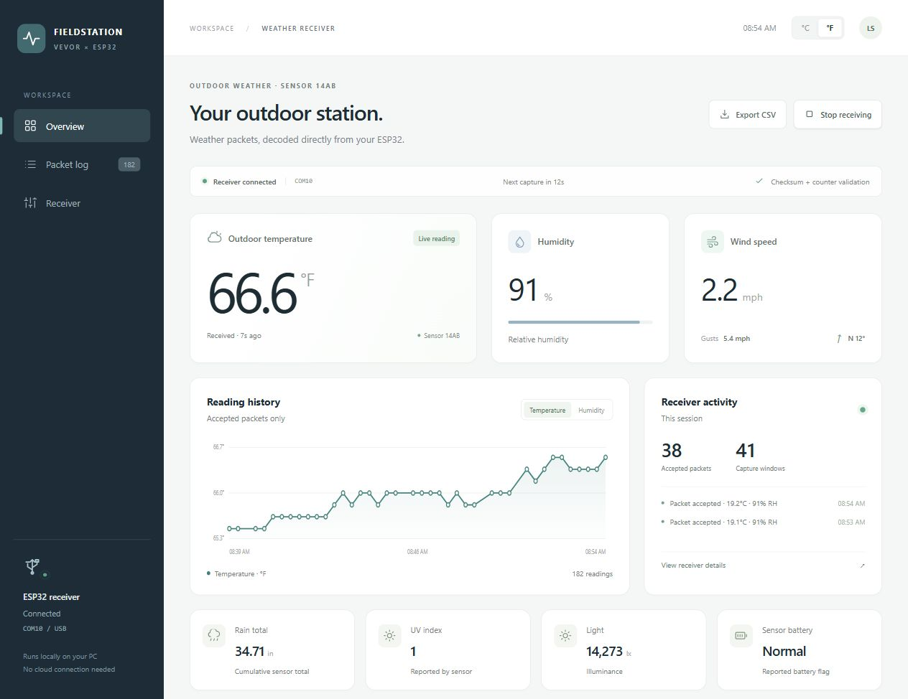
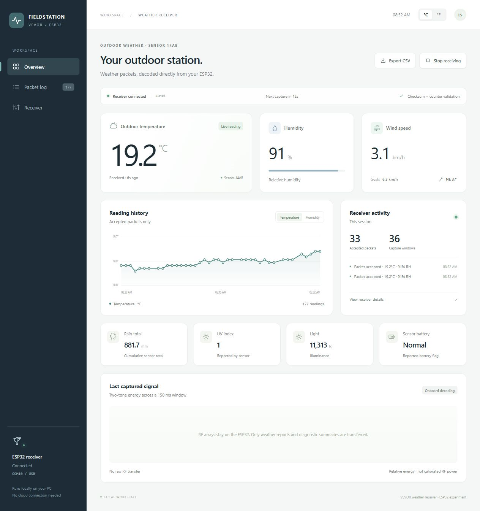
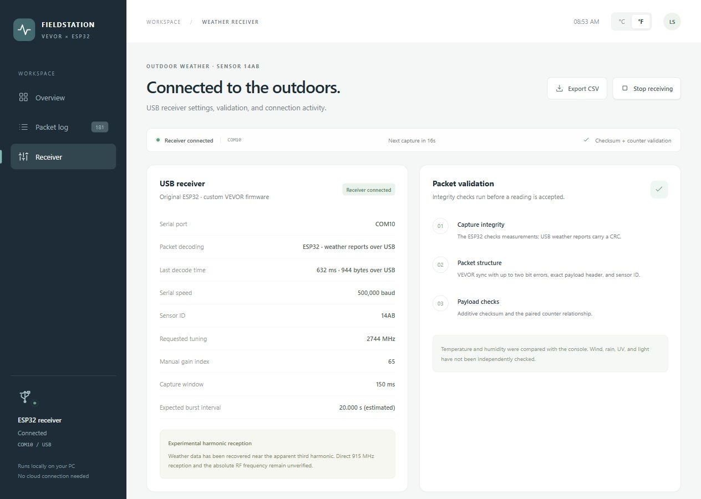

# Dashboard guide

The dashboard runs locally at **http://127.0.0.1:8765**. It displays weather reports decoded by the ESP32, retains accepted readings, and exposes receiver diagnostics. No cloud account is required.

## Display units

Use the **°F / °C** selector in the top-right corner. Temperature, wind speed, gusts, rain, and the temperature history update immediately. The browser remembers the selection across reloads.

| Selection | Temperature | Wind speed and gusts | Cumulative rain |
|---|---|---|---|
| °F | °F | mph | in, two decimal places |
| °C | °C | km/h | mm, one decimal place |

Wind converts from km/h to mph by dividing by **1.609344**. Rain converts from mm to inches by dividing by **25.4**. These are display conversions; the receiver profile, stored measurements, and CSV field units do not change. Humidity, wind direction, UV index, light, and battery status retain their displayed units.

**Rain total is the cumulative sensor counter.** It is not a daily total or rainfall rate. Changing units does not reset that counter.

## Views

| View | What it shows |
|---|---|
| **Overview** | Latest temperature, humidity, wind, gusts, rain, UV, light, battery, accepted-reading history, and receiver activity |
| **Packet log** | Accepted readings, live/saved provenance, station ID, packet checks, and payload inspection |
| **Receiver** | Serial connection, decoding location, measured decoding time, report size, capture timing, connection events, and persistent failure summaries |

Select **Start receiving** to connect to the board, or **Stop receiving** to release its serial port. Historical readings remain visible when reception stops. **Export CSV** downloads the readings currently retained by the dashboard.

**Live** identifies a newly accepted packet. **Saved** identifies a reading restored from disk or a recorded example. Capture-window counts include acquisition scans and quiet periods; they are not counts of sensor transmissions. The UI accepts readings only after the required packet checks pass.

In onboard mode, RF arrays stay on the ESP32. The signal panel therefore explains that no raw RF trace was transferred. Diagnostic records include aggregate validation failures and processing times; historical raw captures from earlier PC-decoding sessions remain available where saved.

## Screenshots

These screenshots were captured from the running dashboard on **November 3, 2026, America/New_York**. They show actual received data from station `14AB`, not generated weather samples. Captures were taken at different moments, so values and counters can differ. The overview and receiver-summary images are cropped at section boundaries; full-page captures are linked below.

### Imperial overview

Fahrenheit selection with wind and gusts in mph, and cumulative rain in inches.

[Open the full imperial overview](images/overview-imperial.jpg).

### Metric overview

Celsius selection with wind and gusts in km/h, and cumulative rain in mm.

### Onboard receiver

The Receiver view shows ESP32 decoding, measured processing time, USB report size, and validation checks. Runtime and report size vary between captures.

[Open the full receiver view, including connection events and capture diagnostics](images/receiver-diagnostics.jpg).

### Earlier experiment images

These remain available for the validation history; they predate the latest unit controls:

- [Earlier live dashboard](images/dashboard-live.jpg)
- [Earlier full dashboard](images/dashboard-full.jpg)
- [Earlier onboard-decoder check](images/dashboard-onboard-decoder.png)
- [Original live prototype](images/dashboard-prototype-live.jpg)

Screenshots demonstrate the interface and recorded observations. They do not establish RF tuning accuracy, range, or long-term reception reliability. See [Validation and limitations](VALIDATION.md).
